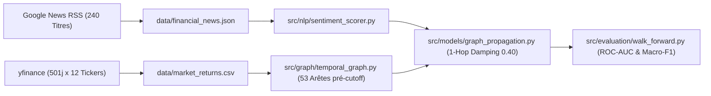
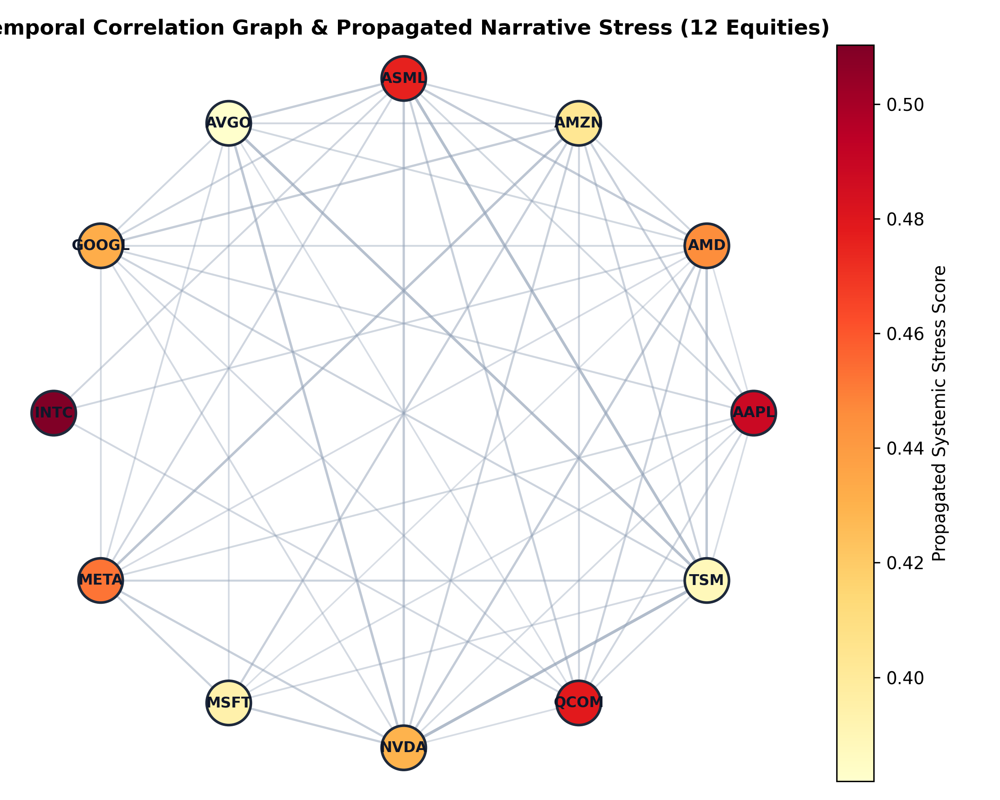
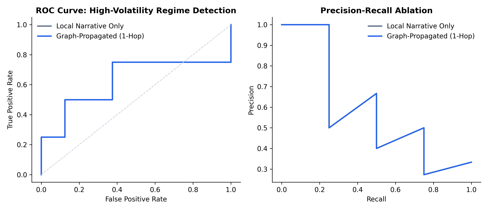
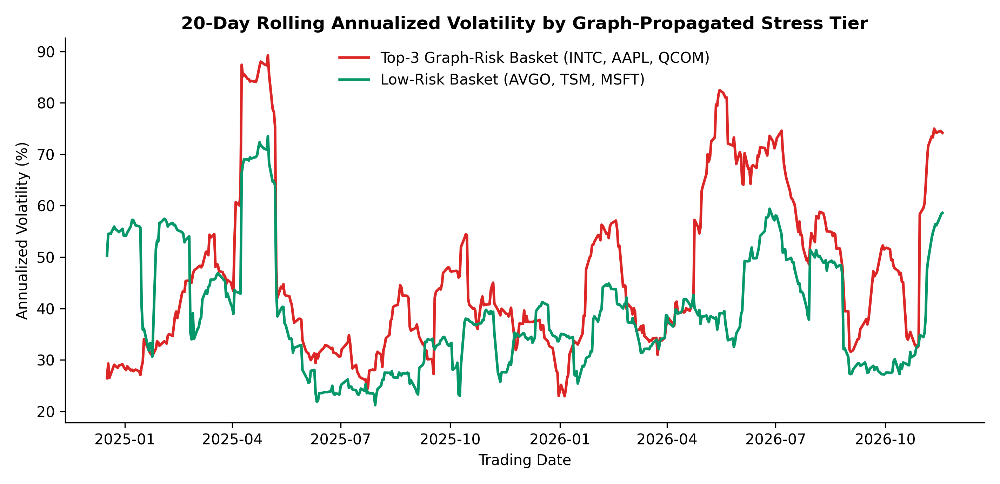

<div align="center">

# FINSG — Financial Narrative & Systemic Graph Intelligence
### Extraction Sémantique & Propagation de Risque par Graphes Temporels (12 Valeurs Tech & Semi-Conducteurs)

<br/>


<br/>

**"From Data to Systems"**  
Système de veille quantitative croisant 501 jours de cotation réelle (`yfinance`) et 240 dépêches financières réelles (`Google News RSS`) sur 12 valeurs semi-conducteurs & Big Tech pour modéliser la contagion de volatilité via un graphe temporel sans fuite future.

</div>

<br/>

<table align="center">
<tr>
<td align="center"><h2>12</h2><sub>valeurs tech & semi-conducteurs</sub></td>
<td align="center"><h2>501</h2><sub>jours de cotation (2 ans)</sub></td>
<td align="center"><h2>240</h2><sub>dépêches financières réelles</sub></td>
<td align="center"><h2>53</h2><sub>arêtes temporelles (r >= 0.35)</sub></td>
<td align="center"><h2>0.6250</h2><sub>ROC-AUC hors-échantillon</sub></td>
<td align="center"><h2>0.6571</h2><sub>Macro-F1 régime haute volatilité</sub></td>
</tr>
</table>

---

## Table des Matières

1. [Problématique & Contagion Systémique](#problématique--contagion-systémique)
2. [Téléchargement, Préparation & Alignement Temporel](#téléchargement-préparation--alignement-temporel)
3. [Architecture & Pipeline de Traitement](#architecture--pipeline-de-traitement)
4. [Méthodologie NLP & Propagation sur Graphe](#méthodologie-nlp--propagation-sur-graphe)
5. [Résultats Empiriques & Preuves Visuelles](#résultats-empiriques--preuves-visuelles)
6. [Dashboard Interactif & Démarrage Rapide](#dashboard-interactif--démarrage-rapide)

---

## Problématique & Contagion Systémique

Dans l'écosystème semi-conducteurs / cloud (`NVDA`, `AMD`, `INTC`, `TSM`, `ASML`, `MSFT`, `AAPL`, `GOOGL`, `AMZN`, `META`, `AVGO`, `QCOM`), un choc sur un fournisseur critique (fonderie, lithographie, demande IA) se répercute sur l'ensemble de la chaîne de valeur. FINSG évalue si la combinaison d'un signal narratif et d'une topologie de corrélation historique prédit les régimes de volatilité réalisée future.

---

## Téléchargement, Préparation & Alignement Temporel

Le module [`src/corpus/download_market_news.py`](./src/corpus/download_market_news.py) exécute l'acquisition et le nettoyage :
1. **Séries boursières (`yfinance`)** : téléchargement des clôtures ajustées sur 2 ans (`period="2y"`) pour les 12 tickers, calcul des rendements journaliers (`pct_change().dropna()`) et sauvegarde dans [`data/market_returns.csv`](./data/market_returns.csv) (`501` jours).
2. **Dépêches financières (`Google News RSS`)** : collecte de 20 dépêches récentes par ticker (`240` titres horodatés) sauvegardées dans [`data/financial_news.json`](./data/financial_news.json).
3. **Garde-fou *Zero Look-Ahead*** : [`filter_documents_before_cutoff`](./src/corpus/document_aligner.py) et [`build_correlation_graph`](./src/graph/temporal_graph.py) excluent strictement toute information postérieure à la date de coupure (`75 %` historique pour le graphe, `25 %` restants pour la volatilité réalisée cible).

---

## Architecture & Pipeline de Traitement



---

## Méthodologie NLP & Propagation sur Graphe

1. **Scoring Sémantique** : extraction de la polarité financière `[-1, 1]` et du ratio d'incertitude `[0, 1]` agrégés par émetteur en score de stress narratif local.
2. **Graphe Temporel** : calcul des corrélations de Pearson historiques sur les `75 %` premiers jours de cotation ; conservation des arêtes de poids $r \ge 0.35$ (`53` arêtes).
3. **Message Passing 1-Hop** : lissage du stress local par la moyenne pondérée des voisins ($s'_i = (1 - \alpha) s_i + \alpha \sum_j w_{ij} s_j / \sum_j w_{ij}$, $\alpha = 0.40$).

---

## Résultats Empiriques & Preuves Visuelles

| Figure | Description |
|---|---|
|  | **Topologie du Graphe Temporel (12 Émetteurs, 53 Arêtes).** Intensité de stress narratif propagé entre valeurs semi-conducteurs et Big Tech. |
|  | **Courbes ROC & Precision-Recall.** Évaluation hors-échantillon sur la détection du tercile de volatilité annualisée élevée (`ROC-AUC = 0.6250`, `Macro-F1 = 0.6571`). |
|  | **Volatilité Glissante 20 Jours.** Comparaison dynamique entre le panier Top-3 risque graphe et le panier faible risque. |

---

## Dashboard Interactif & Démarrage Rapide

- Dashboard HTML5 autonome : [`artifacts/dashboard.html`](./artifacts/dashboard.html)
- Résultats JSON : [`artifacts/results.json`](./artifacts/results.json)

```powershell
.\run.ps1
pytest -v
```
