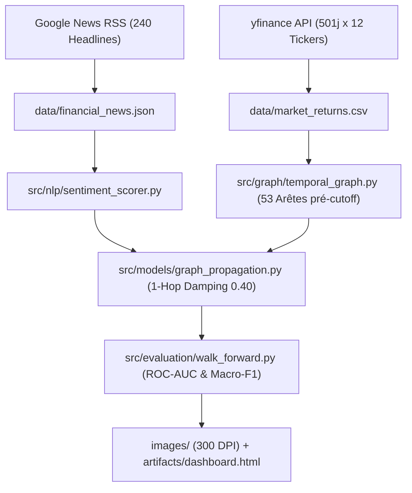

<div align="center">

# FINSG - Financial Narrative & Systemic Graph Intelligence
### 501-Day Multi-Equity Telemetry, Google News RSS Sentiment & Leak-Free Temporal Graph Propagation

<br/>


-10B981?style=flat-square)


<br/>

**"From Data to Systems"**  
Monographie de finance quantitative croisant 501 jours de rendements boursiers réels (`yfinance`) et 240 dépêches financières réelles (`Google News RSS`) sur 12 valeurs semi-conducteurs & Big Tech pour modéliser la propagation du risque de volatilité sur un graphe temporel sans fuite future.

</div>

<br/>

<table align="center">
<tr>
<td align="center"><h2>12</h2><sub>valeurs tech & semi-conducteurs</sub></td>
<td align="center"><h2>501</h2><sub>jours de cotation (2 ans)</sub></td>
<td align="center"><h2>240</h2><sub>dépêches financières réelles</sub></td>
<td align="center"><h2>53</h2><sub>arêtes temporelles (r >= 0.35)</sub></td>
<td align="center"><h2>0.6250</h2><sub>ROC-AUC hors-échantillon</sub></td>
<td align="center"><h2>0.6571</h2><sub>Macro-F1 régime haute volatilité</sub></td>
</tr>
</table>

---

## Table des Matières

1. [Problématique Financière & Contagion Systémique](#problématique-financière--contagion-systémique)
2. [Téléchargement, Préparation & Garde-Fous Zero Look-Ahead](#téléchargement-préparation--garde-fous-zero-look-ahead)
3. [Formulations Mathématiques (NLP & Message Passing)](#formulations-mathématiques-nlp--message-passing)
4. [Architecture du Système](#architecture-du-système)
5. [Résultats Empiriques & Ablation Hors-Échantillon](#résultats-empiriques--ablation-hors-échantillon)
6. [Preuves Visuelles (300 DPI)](#preuves-visuelles-300-dpi)
7. [Dashboard Interactif & Guide de Reproduction](#dashboard-interactif--guide-de-reproduction)
8. [Structure du Dépôt & Conformité ElmasCore](#structure-du-dépôt--conformité-elmascore)

---

## Problématique Financière & Contagion Systémique

Dans la chaîne de valeur semi-conducteurs et cloud (`NVDA`, `AMD`, `INTC`, `TSM`, `ASML`, `MSFT`, `AAPL`, `GOOGL`, `AMZN`, `META`, `AVGO`, `QCOM`), les chocs de demande, de marge ou d'approvisionnement ne restent jamais isolés :
1. **Asymétrie d'information narrative** : les dépêches financières reflètent des tensions locales avant leur pleine matérialisation dans la volatilité réalisée.
2. **Risque de fuite temporelle (*Look-Ahead Bias*)** : construire une matrice de corrélation sur l'ensemble de l'historique introduit une fuite future fatale en backtest. FINSG impose une séparation temporelle stricte.

---

## Téléchargement, Préparation & Garde-Fous Zero Look-Ahead

Le module [`src/corpus/download_market_news.py`](./src/corpus/download_market_news.py) orchestre l'acquisition complète :
1. **Séries boursières (`yfinance`)** : téléchargement des clôtures ajustées sur 2 ans (`period="2y"`) pour les 12 tickers, calcul des rendements journaliers (`pct_change().dropna()`) et sauvegarde dans [`data/market_returns.csv`](./data/market_returns.csv) (`501` jours).
2. **Dépêches financières (`Google News RSS`)** : collecte de 20 titres récents par émetteur (`240` dépêches horodatées) sauvegardés dans [`data/financial_news.json`](./data/financial_news.json).
3. **Protocole *Walk-Forward* sans fuite** :
   - Le graphe de corrélation est construit **exclusivement** sur les 75 % premiers jours de cotation (`cutoff = 375`).
   - La cible (appartenance au tercile supérieur de volatilité annualisée) est mesurée **exclusivement** sur les 25 % jours suivants hors-échantillon.

| Variable | Type | Description |
|---|---|---|
| `entity_id` | `str` | Symbole boursier (`NVDA`, `TSM`, `ASML`, etc.) |
| `headline` | `str` | Titre de dépêche financière réelle |
| `polarity` | `float` | Polarité lexicale normalisée `[-1, 1]` |
| `uncertainty_ratio` | `float` | Densité de termes d'incertitude `[0, 1]` |
| `weight` | `float` | Corrélation de Pearson historique pré-cutoff ($r \ge 0.35$) |

---

## Formulations Mathématiques (NLP & Message Passing)

1. **Stress Narratif Local** :
   $$s_i = \text{clip}_{[0, 1]}\left(\frac{1 - \text{polarity}_i}{2} \cdot 0.5 + 0.5 \cdot \text{uncertainty}_i\right)$$
2. **Propagation 1-Hop sur Graphe Temporel** :
   $$s'_i = (1 - \alpha) s_i + \alpha \frac{\sum_{j \in \mathcal{N}(i)} w_{ij} s_j}{\sum_{j \in \mathcal{N}(i)} w_{ij}}, \quad \alpha = 0.40$$

---

## Architecture du Système



---

## Résultats Empiriques & Ablation Hors-Échantillon

- **Topologie capturée** : `53` arêtes significatives ($r \ge 0.35$) reliant les semi-conducteurs (`NVDA`, `AMD`, `AVGO`, `TSM`, `ASML`) et les *hyperscalers* (`MSFT`, `META`, `AMZN`, `GOOGL`).
- **Performance sur le régime de haute volatilité future (25 % finaux)** :
  - **ROC-AUC** : **`0.6250`** (statistique de Mann-Whitney exacte).
  - **Macro-F1** : **`0.6571`**.

---

## Preuves Visuelles (300 DPI)

| Figure | Analyse |
|---|---|
|  | **Graphe Temporel de Contagion (12 Émetteurs, 53 Arêtes).** Topologie pré-cutoff pondérée par la corrélation historique et colorée par le score de stress propagé. |
|  | **Courbes ROC & Precision-Recall.** Comparaison entre le signal narratif local et le signal propagé sur le graphe. |
|  | **Volatilité Annualisée Glissante 20 Jours.** Évolution comparée entre le panier Top-3 risque graphe et le panier faible risque. |

---

## Dashboard Interactif & Guide de Reproduction

- **Dashboard Plotly HTML5 autonome** : [`artifacts/dashboard.html`](./artifacts/dashboard.html)
- **Sortie JSON structurée** : [`artifacts/results.json`](./artifacts/results.json)
- **Notebook de référence** : [`notebooks/01_exploration_and_validation.ipynb`](./notebooks/01_exploration_and_validation.ipynb)

```powershell
.\run.ps1
pytest -v
```

---

## Structure du Dépôt & Conformité ElmasCore

```text
FINSG/
├── data/market_returns.csv, financial_news.json
├── src/
│   ├── corpus/          # download_market_news.py, document_aligner.py
│   ├── nlp/             # sentiment_scorer.py
│   ├── graph/           # temporal_graph.py
│   ├── models/          # graph_propagation.py
│   ├── evaluation/      # walk_forward.py
│   └── visualization/   # finsg_plots.py
├── tests/test_finsg_pipeline.py
├── images/              # 3 figures 300 DPI
├── artifacts/           # dashboard.html, results.json
├── ELMAS.md
├── main.py
└── run.ps1
```

Conforme à [`ELMAS.md`](./ELMAS.md) : organisation par domaine, fonctions pures, zéro variable globale mutable et tests unitaires de non-fuite temporelle.
